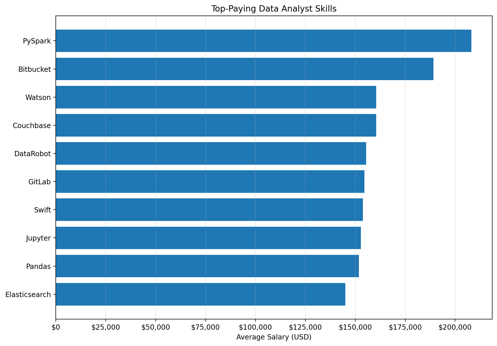

# Introduction
📊This project dives into the data job market, focusing on analyst roles, explores top paying roles and in-demand skills and where high demand meets high salary in data analysis

SQL queries? check them out here: [sql project folder](/project_sql/)
# Background

# Tools I used
- **SQL**
- **PostgresSQL**
- **visual Studio Code**
- **Git & Github**

# The Analysis
Each query for this project is aimed at investigating specific aspects of the data job market. Here's how I approach each question

### 1. Top Paying Data Analyst Roles
To identify the highest paying roles, filtered data analyst positions by average yearly salary and location, focusing on remote jobs. This query highlights the high paying opportunity in the field

```sql
SELECT 
    job_id,
    job_title,
    job_location,
    job_schedule_type,
    salary_year_avg,
    job_posted_date,
    name AS company_name
FROM job_postings_fact
LEFT JOIN company_dim ON job_postings_fact.company_id = company_dim.company_id
WHERE
    job_title_short = 'Data Analyst' AND
    job_location = 'Anywhere' AND
    salary_year_avg IS NOT NULL
ORDER BY salary_year_avg DESC
LIMIT 10
```
Here's a breakdown of the top data analyst jobs in 2023:
-**Wide Salary Range** Top paying data analyst roles span ferom $180,000 indicating significant salary potential in the field.
-**Diverse Employers** Companies like SmartAsset, Meta, and AT&T are among those offering high salaries, showing a broad interest across different industries
-**Job Title Variety**

*Bar chart visualizing the top ten Data Analyst Roles by salary*

## Top-Paying Data Analyst Skills (Tabular Representation)

| Rank | Skill | Average Salary |
|-:|-|-:|
| 1 | PySpark | $208,172 |
| 2 | Bitbucket | $189,155 |
| 3 | Watson | $160,515 |
| 4 | Couchbase | $160,515 |
| 5 | DataRobot | $155,486 |
| 6 | GitLab | $154,500 |
| 7 | Swift | $153,750 |
| 8 | Jupyter | $152,777 |
| 9 | Pandas | $151,821 |
| 10 | Elasticsearch | $145,000 |


# What I learned
What I Learned
- Learned how to analyze data analyst skills based on their average salaries.
- Identified PySpark as the highest-paying skill in my dataset, followed by Bitbucket and Watson.
- Learned that high average salary does not necessarily mean high job demand.
- Improved my ability to interpret SQL query results and present insights using charts and Markdown tables.
- Learned how to document and present my analysis professionally on GitHub using a README file

# Conclusions
## Conclusion

### Insights
- PySpark recorded the highest average salary at **$208,172**, followed by Bitbucket at $189,155.
- Skills such as Pandas, Jupyter, and PySpark highlight the relevance of Python-based tools in data processing and analysis.
- High-paying skills are not necessarily the most demanded. Salary data should be combined with job-posting frequency to identify skills that offer both strong demand and earning potential.

### Closing Thoughts
This project improved my ability to use SQL to analyze salary data, identify patterns, and communicate findings through visualizations and tables. The analysis also emphasized the importance of combining salary insights with skill demand when making career decisions. Going forward, I aim to explore more job-market data to identify the most valuable skills for aspiring data analysts.
